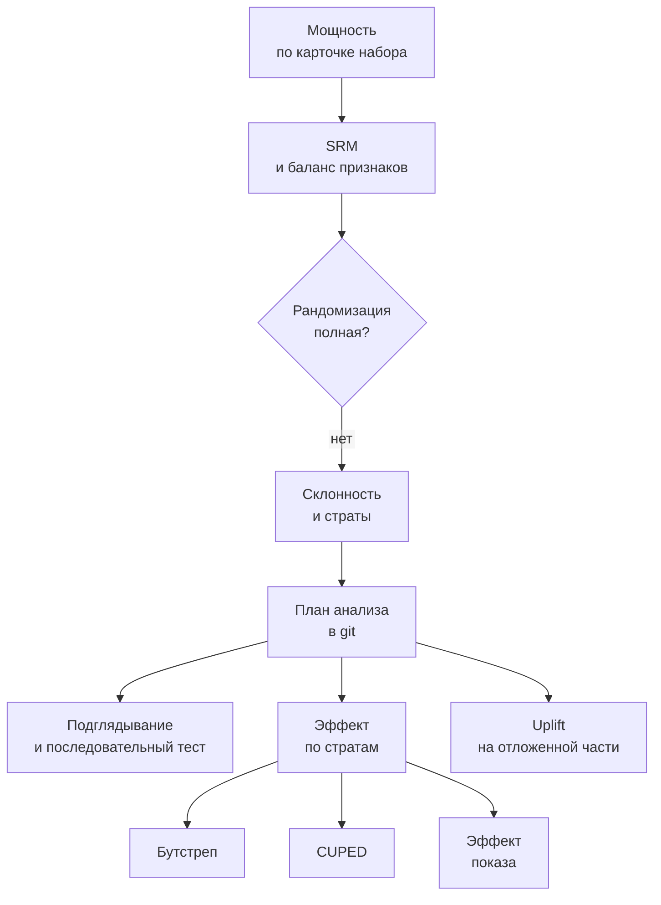
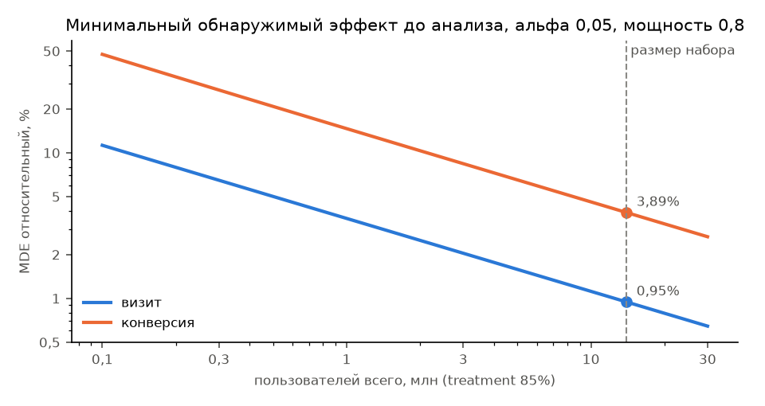
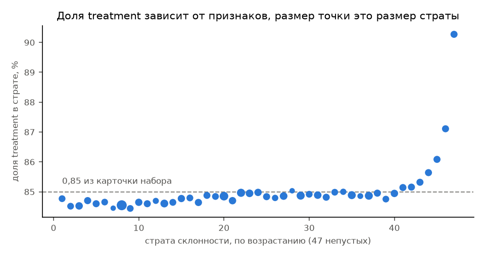
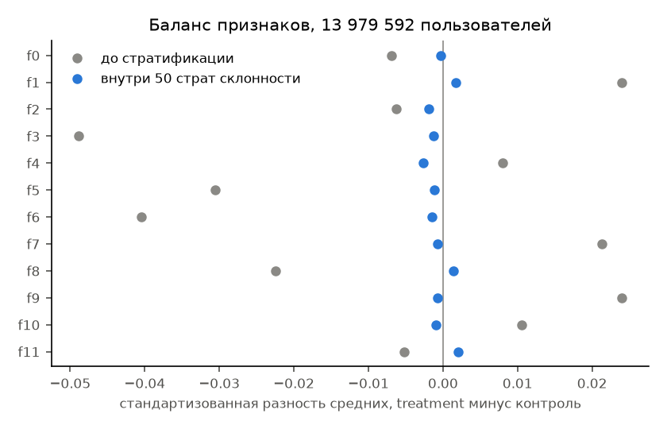
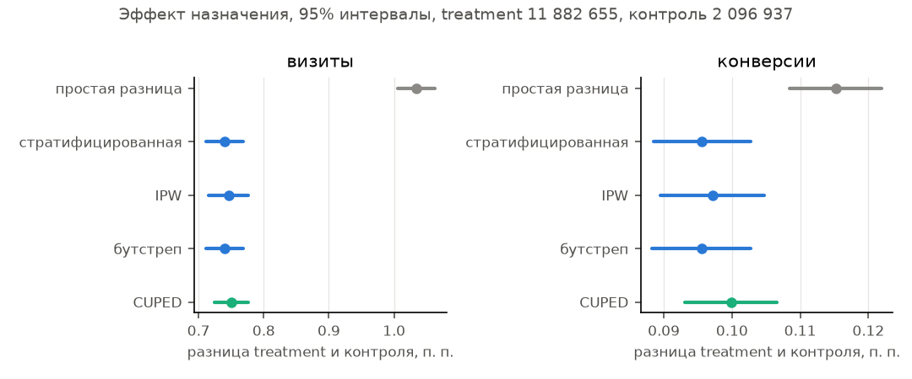
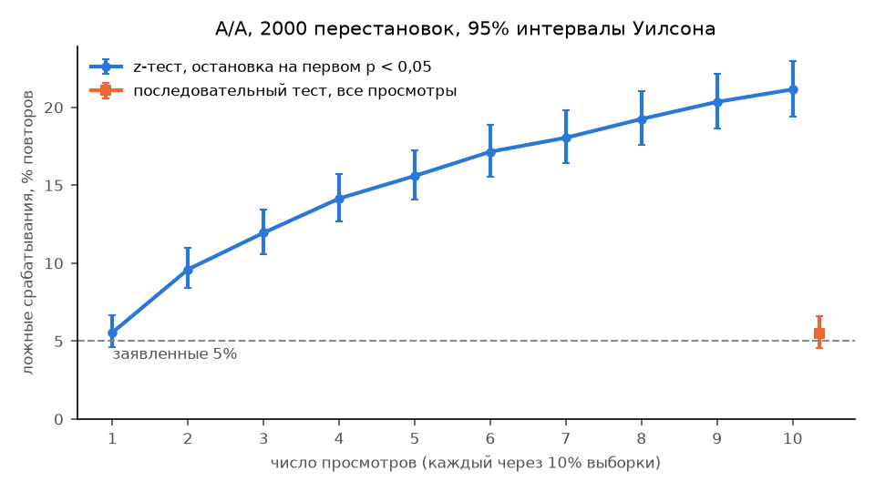
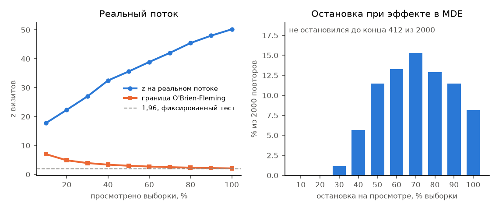
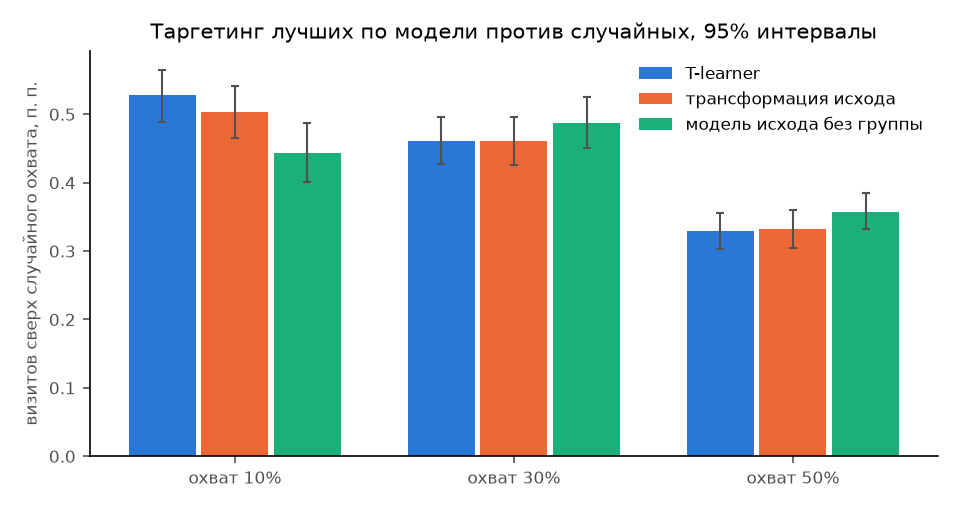
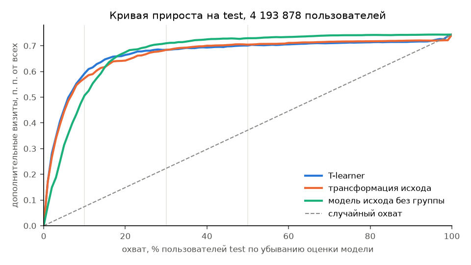

# A/B-эксперимент на Criteo Uplift

Разбор рандомизированного эксперимента с рекламой на открытом наборе Criteo Uplift v2.1, около 14 млн пользователей. Вопрос в том, насколько показ рекламной кампании меняет долю пользователей, которые зашли на сайт рекламодателя. Мощность посчитана до анализа, рандомизация проверена до просмотра исходов, план анализа закоммичен раньше кода, который читает исходы (коммит `2c7032d`, файл [docs/analysis_plan.md](docs/analysis_plan.md)).

Противоположный случай, оценка эффекта без рандомизации на наблюдательных данных, разобран в соседнем проекте [msk-rent-market](https://github.com/nata2627/msk-rent-market/blob/main/methods/cut_effect.md) на примере снижения цены аренды.



## Результат

| Что | Число |
|---|---|
| Эффект назначения на визиты, основная метрика | +0,740 п. п. (95% ДИ 0,711-0,769 п. п.), относительно +18,3% (17,4-19,1%) |
| Доля визитов в контроле и treatment | 4,05% и 4,79% |
| Эффект на конверсии, вторичная метрика | +0,096 п. п. (0,088-0,103 п. п.), относительно +45,8% (41,1-50,6%) |
| Простая разница долей на визитах (смещена, решения по ней не принимаются) | +1,034 п. п. (1,006-1,063 п. п.) |
| Ложные срабатывания A/A при подглядывании на 10 просмотрах | 423 из 2000 (21,2%) против 111 из 2000 (5,6%) при одном просмотре |
| Последовательный тест на тех же симуляциях | 110 из 2000 (5,5%), мощность 79,4% против 80,4% у фиксированного |
| CUPED на визитах | интервал уже на 10,4%, снято 19,8% дисперсии |

Главная находка до всякого эффекта в том, что рандомизация в наборе условная. Набор склеен из нескольких тестов с разной долей treatment, и признаки предсказывают группу. Простая разница средних на визитах на 40% больше стратифицированной оценки, это 20 стандартных ошибок, и при условной рандомизации это смещение простой разницы. Основная оценка стратифицирована по склонности к назначению.

## Данные и лицензия

Criteo Uplift v2.1, 13 979 592 пользователя, признаки f0..f11 (анонимизированы и случайно спроецированы), назначение `treatment`, показ `exposure`, исходы `visit` и `conversion`. Лицензия CC BY-NC-SA 4.0, поэтому данные в репозиторий не кладутся. Их скачивает `scripts/download_data.sh` и сверяет sha256.

Diemert E., Betlei A., Renaudin C., Amini M.-R. A Large Scale Benchmark for Uplift Modeling. AdKDD 2018. Страница набора на Hugging Face `criteo/criteo-uplift`.

## Мощность до анализа

Базовые доли взяты из карточки набора, исходы данных для них не использовались. Группы 11 882 655 и 2 096 937, двусторонний z-тест, альфа 0,05, мощность 0,8 (`results/power.json`).

| Метрика | Доля из карточки | MDE абсолютный | MDE относительный |
|---|---|---|---|
| визит | 0,046992 | 0,044 п. п. | 0,95% |
| конверсия | 0,00292 | 0,011 п. п. | 3,9% |

При разбиении поровну хватило бы 7,2 млн пользователей вместо 14 млн. Наблюдаемая мощность после эксперимента не считалась. Найденный эффект на визиты в 16,6 раза больше абсолютного MDE.



## Рандомизация

**SRM.** Treatment 11 882 655 из 13 979 592, доля 0,8500001. Хи-квадрат против 0,85 из карточки дает p = 0,999, но совпадение слишком точное. Treatment всего на 1,8 пользователя больше, чем ровно 0,85 от выборки, а при честном биномиальном назначении так близко попадают с вероятностью 0,0012 (`results/srm.json`). Совпадение слишком точное для случайного назначения, вероятнее всего, это прореживание, о котором пишет карточка. Поэтому SRM против 0,85 рандомизацию здесь не проверяет.

**Баланс признаков.** Максимальная стандартизованная разность 0,049 (f3). AUC классификатора «группа по признакам» на 2 000 000 отложенных строк 0,5089 (95% ДИ 0,5080-0,5098) у логистической регрессии и 0,5095 (0,5084-0,5106) у бустинга. Отклонение от 0,5 маленькое, но на таком размере надежное (`results/randomization.json`).

**Структура.** По 39 частым комбинациям значений признаков доля treatment меняется от 0,844 до 0,887, хи-квадрат 4440 на 38 степенях свободы. Отдельные подтесты из признаков не восстанавливаются, зависимость плавная (`results/randomization_structure.json`).

**Что сделано.** Предполагается условная рандомизация, назначение не зависит от исходов при данных признаках. Склонность P(treatment | признаки) оценена бустингом вне фолда, выборка разрезана на 50 квантилей склонности, из них 3 пустые из-за совпадающих значений, оценка идет по 47 стратам. Внутри страт максимальная стандартизованная разность 0,0026, при обратном взвешивании 0,0010. Доля treatment по стратам от 0,844 до 0,903.





## Основной эффект

Оценка стратифицированная, разница долей внутри каждой страты с весом, равным доле страты в выборке, дисперсия Вальда по стратам (`results/main.json`). Правило из плана анализа такое, эффект признается, если 95% интервал не накрывает ноль.

| Оценка | Визиты | Конверсии |
|---|---|---|
| стратифицированная (основная) | +0,740 п. п. (0,711-0,769 п. п.) | +0,096 п. п. (0,088-0,103 п. п.) |
| обратное взвешивание по склонности | +0,746 п. п. (0,716-0,777 п. п.) | +0,097 п. п. (0,090-0,105 п. п.) |
| бутстреп | +0,740 п. п. (0,711-0,768 п. п.) | +0,096 п. п. (0,088-0,103 п. п.) |
| CUPED | +0,750 п. п. (0,724-0,776 п. п.) | +0,100 п. п. (0,093-0,107 п. п.) |
| простая разница | +1,034 п. п. (1,006-1,063 п. п.) | +0,115 п. п. (0,108-0,122 п. п.) |

Стратифицированная и взвешенная оценки расходятся на 0,43 стандартной ошибки на визитах и на 0,43 на конверсиях, порог плана в одну ошибку не превышен.



## Бутстреп

Пуассоновский бутстреп, каждой строке вес Poisson(1), 2000 повторов, seed 20261025, страты фиксированы. Ширина бутстреп-интервала 0,98 от аналитической на визитах и 1,01 на конверсиях, на таком размере аналитическому интервалу можно верить (`results/bootstrap.json`). Неопределенность самой склонности бутстреп не учитывает, склонность в повторах не переобучалась.

## CUPED

Предэкспериментальной метрики в наборе нет, поэтому ковариатой служит линейная комбинация признаков f0..f11, коэффициенты по объединенной выборке, признаки отцентрированы внутри страт (`results/cuped.json`).

| Метрика | Снято дисперсии | Интервал уже на | Сдвиг оценки, стандартных ошибок |
|---|---|---|---|
| визиты | 19,8% | 10,4% | 0,67 |
| конверсии | 10,3% | 5,3% | 1,17 |

CUPED законен, если ковариата не зависит от группы. Карточка прямо не говорит, что признаки сняты до воздействия, косвенная проверка это баланс внутри страт. Сдвиг оценки меньше порога плана в две ошибки, но на конверсиях он больше собственного разброса сдвига, вероятно, из-за остаточного дисбаланса в стратах.

## Эффект показа

Назначение рандомизировано, показ нет. Показ получили 3,6% пользователей treatment и 0 из 2 096 937 в контроле. Эффект на тех, кто получил показ из-за назначения, оценен с `treatment` как инструментом для `exposure`. Визиты +20,97 п. п. (20,15-21,78 п. п.), конверсии +2,71 п. п. (2,51-2,91 п. п.). Оценка держится на допущении, что назначение влияет на исход только через показ, и чувствительна к его нарушению, потому что показ получила малая доля treatment. Эту величину нельзя сравнивать с эффектом назначения выше, она про другую совокупность.

## Подглядывание и последовательный тест

Времени в данных нет. Поток моделируется перестановкой, пользователи перемешаны с seed 20261025 и приходят по одному, просмотр каждые 10% выборки, всего 10 просмотров. A/A строится перестановкой меток группы внутри страт, 2000 повторов (`results/peeking.json`).

Если останавливаться на первом p < 0,05, ложные срабатывания растут с 5,6% (111 из 2000, интервал Уилсона 4,6-6,6%) до 21,2% (423 из 2000, 19,4-23,0%), в 3,8 раза.

Лечение это групповой последовательный дизайн с функцией расходования альфы Lan-DeMets типа O'Brien-Fleming. Границы по z от 6,99 на первом просмотре до 2,08 на последнем. На тех же перестановках ложные срабатывания 110 из 2000 (5,5%, 4,6-6,6%). С внесенным эффектом размером в MDE визитов мощность 79,4% (77,6-81,1%) против 80,4% у фиксированного теста, потеря 1,0 п. п., а выборки в среднем нужно на 24% меньше (`results/sequential.json`).

На реальном потоке последовательный тест остановился бы на первом просмотре, на 10% выборки, z = 17,8 при границе 6,99, вывод рост визитов.





## Uplift, кому показывать рекламу

Если показ стоит денег, полезно знать, на кого он действует. Train 9 785 714 пользователей, test 4 193 878, LightGBM 300 деревьев, 31 лист, шаг 0,05. Две uplift-модели (T-learner и трансформация исхода с поправкой на склонность) против двух бейзлайнов, случайного порядка и модели исхода без учета группы. Метрики на test взвешены обратно склонности, интервалы бутстрепом по test, 500 повторов (`results/uplift.json`).

| Модель | Нормированный Qini, 95% ДИ |
|---|---|
| T-learner | 0,0688 (0,0633-0,0744) |
| трансформация исхода | 0,0683 (0,0626-0,0740) |
| модель исхода без группы | 0,0700 (0,0644-0,0759) |
| случайный порядок | 0,0004 (-0,0035-0,0041) |

Правило приемки из плана (нижняя граница Qini выше нуля и выше Qini модели исхода) не прошла ни одна uplift-модель. Модель исхода ранжирует почти так же хорошо.

Полный эффект на test 0,743 п. п. от всех пользователей. Охват 10% лучших по T-learner дает 0,609 п. п., это 82% полного эффекта, при 30% охвата 0,684 п. п. (92%), при 50% 0,701 п. п. (94%). У модели исхода те же доли 71%, 95% и 98%.



Сравнения ниже в плане не было, оно добавлено после первых чисел и подается как наблюдение. Разница визитов T-learner минус модель исхода на 10% охвата +0,085 п. п. (0,057-0,117 п. п.), на 30% -0,026 п. п. (от -0,048 до -0,001 п. п.), на 50% -0,028 п. п. (от -0,050 до -0,005 п. п.). Uplift-модель выигрывает только на самом узком охвате.



## Что не получилось и ограничения

- Рандомизация в наборе условная. Стратификация по склонности снимает зависимость от признаков, но если принадлежность к подтесту зависит от того, чего в признаках нет, остаточное смещение остается, и проверить это нечем.
- SRM против заявленной доли здесь бесполезен, совпадение с ней слишком точное для случайного назначения. Проверка рандомизации держится на балансе признаков.
- Неопределенность оценки склонности в интервалы не входит.
- CUPED на конверсиях сдвигает оценку сильнее собственного шума. Порог плана не превышен, но причину до конца выяснить не удалось.
- Подглядывание показано на перестановке пользователей, реального времени в данных нет. Реальный поток эксперимента с дрейфом аудитории мог бы дать другую картину.
- Uplift-модели не обошли модель исхода по Qini. mSPRT вторым последовательным методом и подбор гиперпараметров uplift-моделей не делались.
- В плане анализа два отступления, записанные отдельным разделом с причинами, пустые страты и нормировка Qini, плюс сравнение uplift с моделью исхода вне плана.

## Как воспроизвести

```bash
python3.11 -m venv .venv && .venv/bin/pip install -r requirements.txt
scripts/download_data.sh                # сверка sha256
.venv/bin/python -m src.data            # csv.gz в parquet
.venv/bin/python -m src.srm
.venv/bin/python -m src.balance
.venv/bin/python -m src.structure       # склонность и страты
.venv/bin/python -m src.power
.venv/bin/python -m src.effect
.venv/bin/python -m src.bootstrap
.venv/bin/python -m src.cuped
.venv/bin/python -m src.peeking         # продолжает с места обрыва
.venv/bin/python -m src.uplift
.venv/bin/python -m src.summary
.venv/bin/python -m src.figures
scripts/check.sh                        # линтер, тесты, сверка чисел README
```

Полный прогон на ноутбуке занимает около часа, дольше всего бутстреп, симуляции подглядывания и uplift. Время и пик памяти каждого шага пишутся в его файл в `results/` (поля `seconds`, `peak_memory_gb`), поэтому после своего прогона сверку чисел README делайте на закоммиченных `results/`: от машины к машине меняются только эти поля.

Все числа этого текста лежат в `results/*.json`, их пишет код. `scripts/verify_numbers.py` проверяет, что у каждого числа README есть источник в `results/` с точностью до напечатанного округления, и падает, если источника нет. Seed каждого расчета записан в его файл результата.

## Структура

| Путь | Что там |
|---|---|
| `docs/analysis_plan.md` | план анализа, записан до исходов, отступления в конце |
| `src/` | расчеты, по модулю на этап |
| `tests/` | тесты на синтетике с известным ответом |
| `results/` | числа, которые пишет код |
| `figures/` | графики, строятся только из `results/` |
| `scripts/` | скачивание данных, проверка, сверка чисел |
